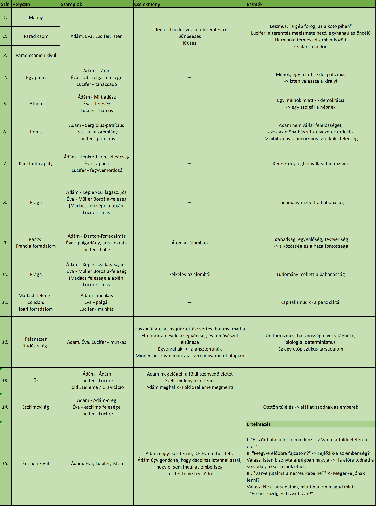

# Madách Imre - Az ember tragédiája:

- műfaj: emberiség költemény
- kor: romantika
- téma: Mi a történelem?

## Források: 
- Biblia 
- Darvin: Fajelméletek
- Goethe: Faust
- Dante: Isteni színjáték
- Hegel (filózófus)

## Hegeli triáda:
- tézis = állítás
- antitézis = ellenállítás
- szintézis = egybefogja a tézist és az antitézist->ez lesz az új tézis

## Madách elmélete:
- Az eszmék is fejlődnek.
- Az eszméket közösségek hozzák létre így az eszme közös, de emberiség egyénekből áll.
- Az emberiségnek összesen 10 ezer éve van, mert a Nap ki fog hülni.

## Szerkezet : 
**15 szín:**
- 1-3. keresztszín, bibliai keret
- 4-14. álomszínek, történelmi színek
- 15 . keresztszín, bibliai keret

## Értelmezés:
**1.** *"E szűk határú lét-e minden?"* --> Van-e élet a földön kívül?
- Isten bizonytalanságban hagyja --> ha előre tudod a sorsod nem számít az út

**2.** *"Megy-e előre fajzatom?"* --> Fejlődik e az emberiség?
- nem válaszol 

**3.** *"Van-e jutalma e nemes kebleknek?"* --> Megéri-e helyesen cselekedni?
- az embernek önmaga miatt kell elkölcsösnek lennie
- *"Ember küzdj és bízva bízzál"*
