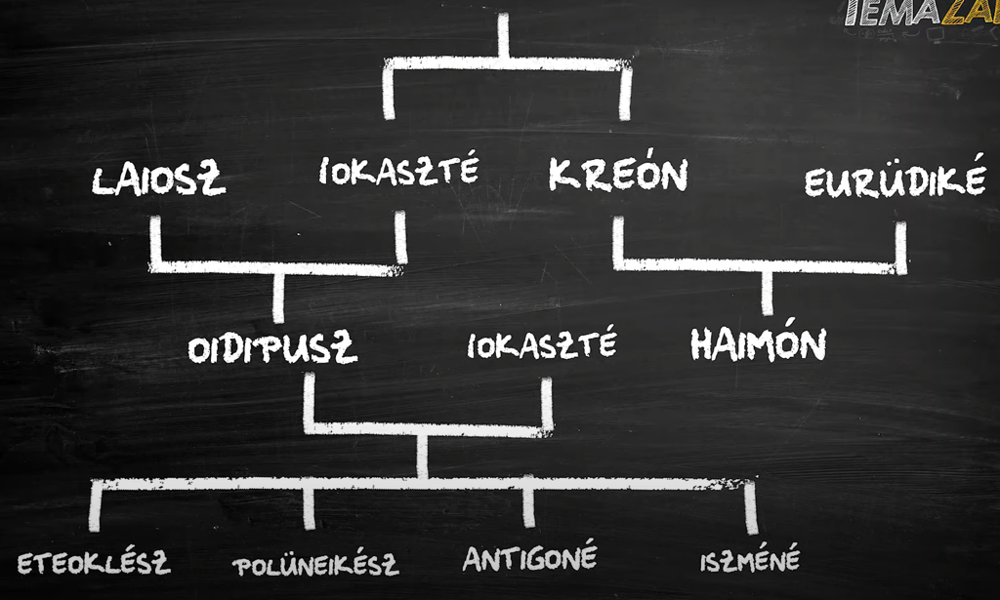

# Szophoklész: Antigóné
- tragédia (+konfliktusos dráma)
- ókor

## Szereplők:

- Antigóné: Oidipusz lánya, el akarja temetni testvérét Polüneikészt
- Iszméné: Antigóné testvére, fél Kreón haragjától, nem segít a temetésben
- Kreón: Théba királya, szigorú, megtiltotta Polüneikész eltemetését
- Haimón: Kreón fia, Antigóné szerelme, megpróbálta meggyőzni apját
- Teiresziasz: vak jós, aki figyelmezteti Kreónt, hogy rossz döntést hoz
- Eurüdiké: Kreón felesége, Haimón anyja
- Polüneikész: Antigóné, Iszméné és Eteoklész testvére (belehalt kettőjük harcába)
- Eteoklész: Antigóné testvére, megölte Polüneikészt, ő is meghalt
- Kar: Théba véneiből álló csoport, akik kommentálják az eseményeket

## Történet:
 Oidipusz két fia, Eteoklész és Polüneikész egymás ellen harcolnak Théba trónjáért, és mindketten meghalnak. Kreón, az új király úgy rendelkezik, hogy Eteoklészt tisztességesen el kell temetni, Polüneikészt viszont tilos eltemetni, mert árulónak tartja. 
 Antigoné nem fogadja el a király parancsát, mert szerinte az isteni törvények szerint minden halottnak jár a temetés. 
 Titokban eltemeti testvérét, ezért Kreón halálra ítéli, és egy sziklasírba záratja.Haimón megpróbálja lebeszélni apját a döntéséről, de Kreón hajthatatlan marad. 
 Teiresziasz, a vak jós figyelmezteti Kreónt, hogy az istenek haragszanak rá. Kreón végül meggondolja magát, de már túl késő.
 Antigoné felakasztotta magát a sírban. Haimón, amikor meglátja halott szerelmét, öngyilkos lesz. Haimón halála után anyja, Eurüdiké is véget vet életének. Kreón egyedül marad, és rádöbben hibájára.

## Értelmezés:
- Az isteni és emberi törvények konfliktusa:
 Az embernek tisztelnie kell az Isteni törvényeket, mert megtagadásuk tragédiához vezethet.
 A túlzott makacsság és büszkeség is káros.
- Kreón saját magát az istenek fölé helyezi --> hübrisz

[Videó](https://youtu.be/mEO_CozL7fw)